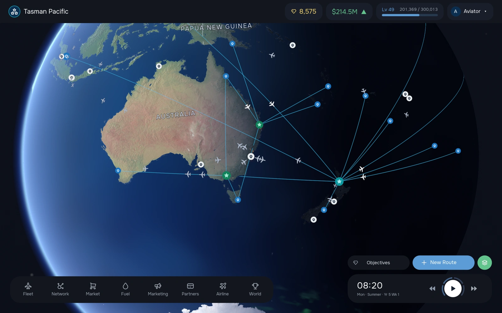
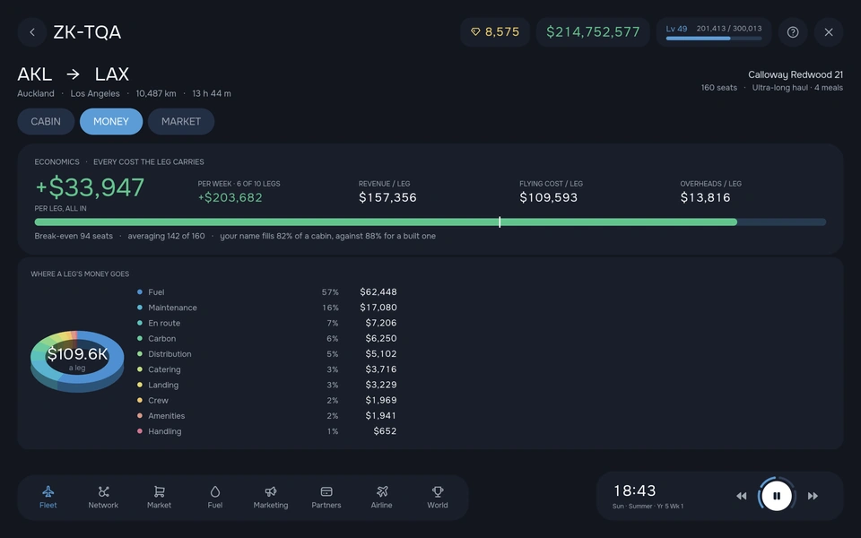
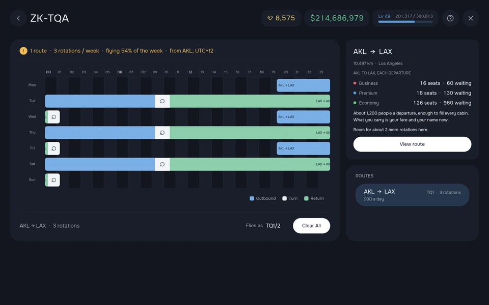
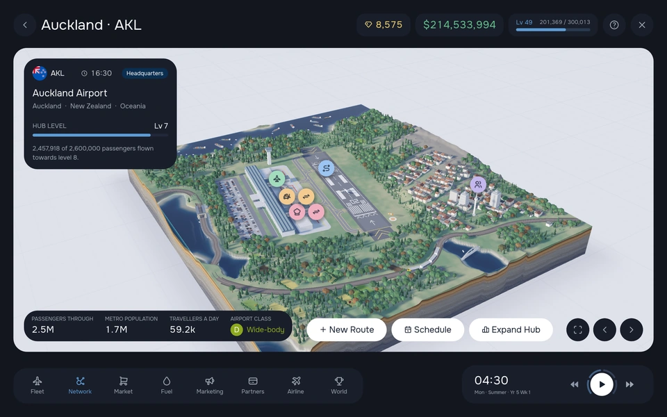
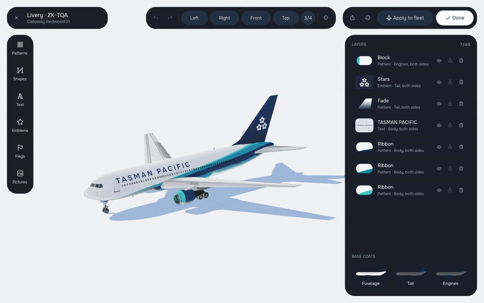
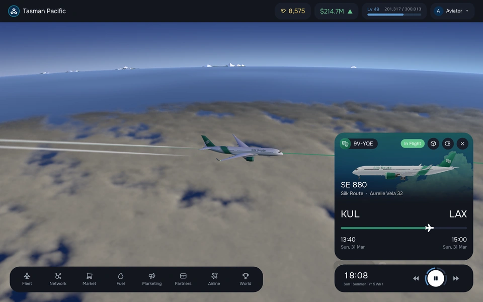
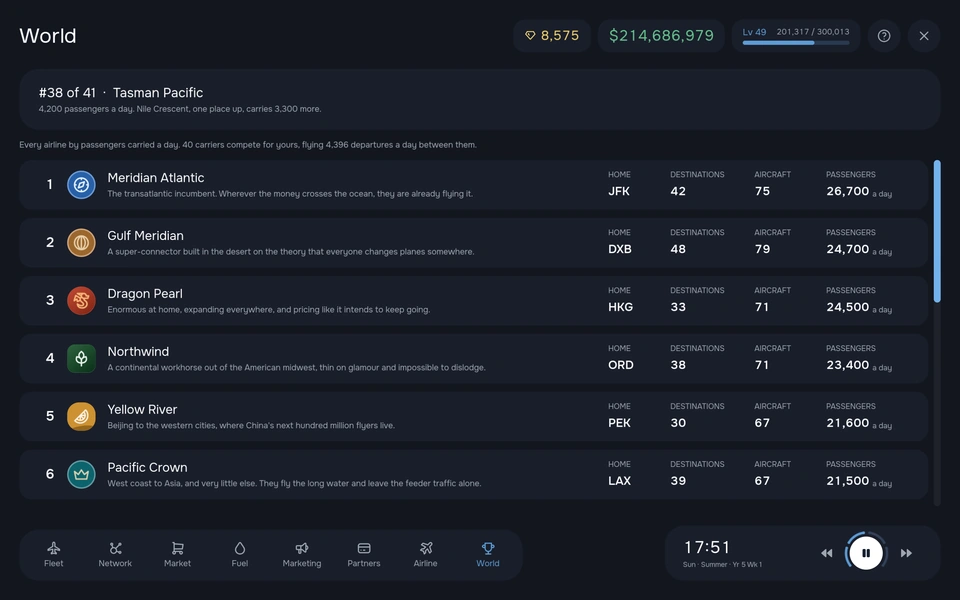

# Vreeburg Games

**An independent studio making simulation games for people who like to know how things work.**

---

## ✈️ Project Airline

*Build your airline on a 3D globe.*

**Project Airline** is a single-player airline management game. You buy aircraft, base them at hubs, draw routes between real airports, fit the cabins, price the seats and run the timetable that pays for all of it.

The simulation is the game:

- **Real airports, real demand.** 220+ real airports in their actual locations, with their real passenger numbers and night curfews. Traffic flows between city pairs, so a second aircraft on a full route splits the passengers instead of inventing more.
- **Honestly costed aircraft.** 27 aircraft types, from a 30-seat turboprop to the double-deck Celeste 52. The types and manufacturers are fictional, but each is modelled on a real class of airliner with realistic seat counts, ranges and fuel burn. Order or lease them, and lay out every cabin yourself.
- **Every cost line accounted for.** Fuel (bought at a moving spot price, with a sustainable aviation fuel blend you choose), crew, maintenance, catering, ground handling, landing fees, carbon, and the cost of owning your fleet. Earn it back in fares, extras, belly cargo and loyalty.
- **A week you build by hand.** Lay rotations out on a weekly timetable with honest block and turnaround times and a flight number for every departure.
- **Hubs that grow into places.** Ten hub levels that traffic unlocks and money builds. Every hub has a clay-model diorama of its airport and the city beside it, with a plane flying a full circuit and the lights coming on after dark.
- **An airline that is yours.** Pick its name and IATA code, draw its logo, paint its liveries layer by layer in 3D, and print its boarding passes. Share designs with anyone as a design code.
- **A sky full of rivals.** Share the world with up to 100 fictional AI airlines, each flying its own timetable from its own hubs. Launch a frequent flyer programme, codeshare with the carriers you meet, and join one of three alliances or found your own.
- **Ride along.** Press 3D on any flight in the air and the camera dives from orbit to the aircraft, in its livery, over the real ground below.

<table>
  <tr>
    <td width="33%"></td>
    <td width="33%"></td>
    <td width="33%"></td>
  </tr>
  <tr>
    <td align="center">Every cost a flight carries</td>
    <td align="center">Lay out your weekly timetable</td>
    <td align="center">Grow your hubs</td>
  </tr>
  <tr>
    <td width="33%"></td>
    <td width="33%"></td>
    <td width="33%"></td>
  </tr>
  <tr>
    <td align="center">Paint your liveries</td>
    <td align="center">Ride along with any flight</td>
    <td align="center">Climb the world ranking</td>
  </tr>
</table>

Project Airline is in development and **coming soon to Steam**. There is no release date yet.

---

## 🌐 On projectairline.com

| Page | What's there |
| :--- | :--- |
| [Wiki](https://projectairline.com/wiki) | How the game works, read straight off its own data: [Getting Started](https://projectairline.com/wiki/getting-started), [Gameplay](https://projectairline.com/wiki/gameplay), [Your Airline](https://projectairline.com/wiki/your-airline), [Rivals & Alliances](https://projectairline.com/wiki/rivals-and-alliances), [Aircraft](https://projectairline.com/wiki/aircraft) and [World](https://projectairline.com/wiki/world), where every airport's diorama can be explored in 3D |
| [Airlines](https://projectairline.com/airlines) | Players' airlines ranked by level, with their logos, liveries, fleets and route maps. Sign in with Steam to see yours, or hide it |
| [Forums](https://projectairline.com/forums) | Questions, liveries, route maps, ideas and bug reports. Anyone can read; owners of the game can post |
| [Gallery](https://projectairline.com/gallery) | Screenshots of the game in action |
| [FAQ](https://projectairline.com/faq) · [About](https://projectairline.com/about) | Common questions, and how the game got here |

---

## 💬 Say hello

Want to playtest, suggest a feature or talk about airplanes? Join us on **[Discord](https://discord.gg/mVbD4HsKrA)** to follow development and see new builds first.

   
  Built in Godot and C#. Made for aviation nerds.

